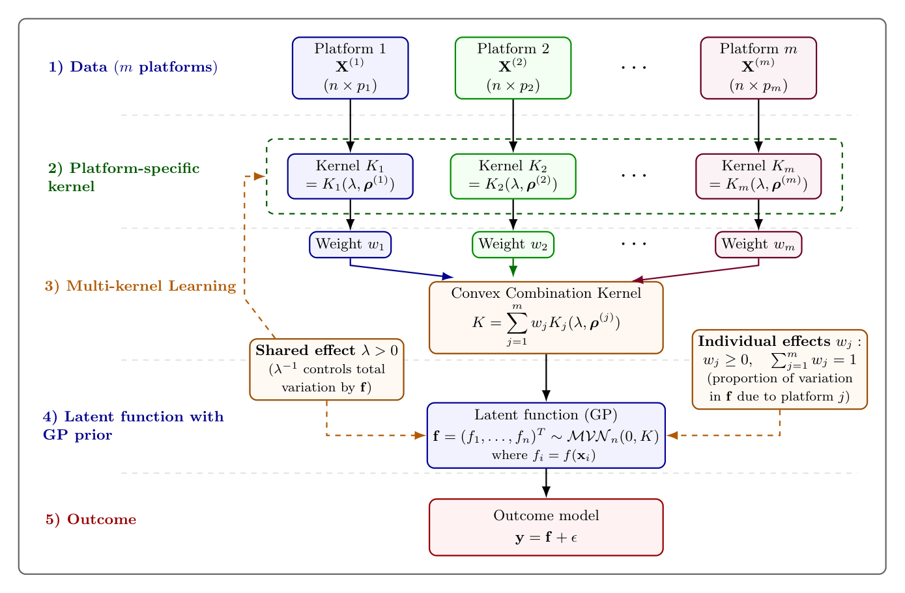
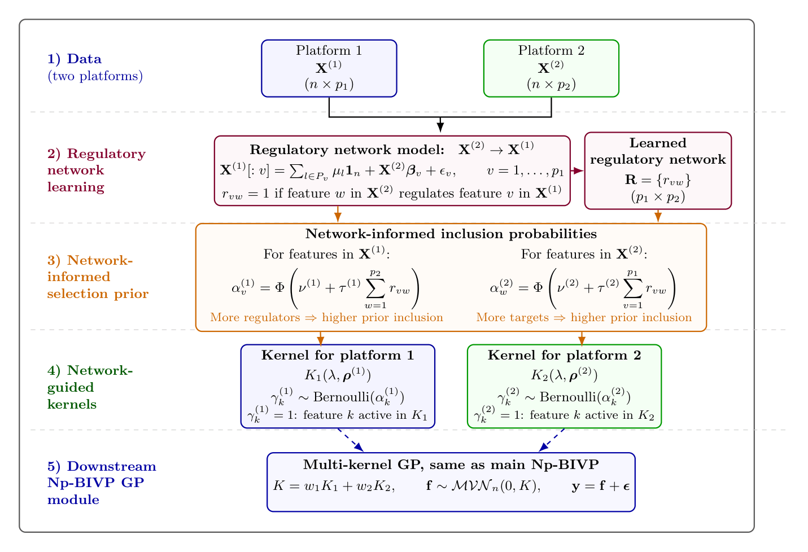

<!-- README.md is generated from README.Rmd. Please edit README.Rmd instead. -->

```{r, include = FALSE}
knitr::opts_chunk$set(
  collapse = TRUE,
  comment = "#>",
  fig.path = "man/figures/README-",
  out.width = "100%"
)
```

# npbivp

### Bayesian Multi-Kernel Gaussian Process for Nonlinear Multi-Omics Data Integration

An R package implementing the **NPBIVP** and **NPBIVPR** methodologies for simultaneous biomarker selection, nonlinear multi-omics integration, outcome prediction, and biologically-informed regulatory network learning.

---

## Overview

Recent advances in high-throughput technologies allow multiple molecular layers (e.g. gene expression, miRNA expression, DNA methylation and proteomics) to be measured on the same biological samples.

However, existing methodologies often suffer from one or more of the following limitations:

- linear modeling assumptions,

- lack of embedded variable selection,

- black-box prediction mechanisms,

- inability to accommodate censored survival outcomes,

- inability to incorporate prior biological information.

`npbivp` addresses these limitations through Bayesian multi-kernel Gaussian processes.

The package currently implements two methodologies.

**NPBIVP**

Non-parametric Bayesian Integrative Variable Selection and Prediction.

**NPBIVPR**

An extension of NPBIVP that jointly learns regulatory networks between two omics platforms.

---

## Core functionalities

`npbivp` simultaneously performs

- nonlinear multi-omics integration,

- platform-specific Bayesian variable selection,

- outcome prediction for continuous and right-censored survival outcomes,

- interpretable multi-kernel learning,

- biologically-informed regulatory network integration.

### Interpretable platform weights

A key innovation of NPBIVP is the estimation of identifiable convex kernel weights

$$
w_1,\dots,w_m
$$

satisfying

$$
w_j \ge 0,\qquad \sum_{j=1}^m w_j =1.
$$

These weights quantify the relative predictive contribution of each omics platform and therefore provide an interpretable measure of platform importance.

---

## Method overview

### NPBIVP framework

NPBIVP constructs one Gaussian process kernel per omics platform and combines them through identifiable convex kernel weights.

The resulting latent Gaussian process simultaneously performs nonlinear integration, variable selection and outcome prediction.

<p align="center">

</p>

### NPBIVPR framework

NPBIVPR extends NPBIVP by jointly learning regulatory networks between two omics platforms.

External biological information (e.g. KEGG pathways or miRNA-target databases) can be incorporated to inform biomarker selection through network-guided priors.

<p align="center">

</p>

---

## Relationship to previous work

### Savitsky et al. (2011)

Savitsky et al. (2011) introduced Gaussian process variable selection for a single predictor platform under continuous outcomes.

This formulation is recovered as a special case of NPBIVP when

```r
m = 1
```

NPBIVP substantially extends their methodology by incorporating

- multiple omics platforms,

- interpretable platform weights,

- right-censored survival outcomes,

- regulatory network integration.

### Chekouo et al. (2015)

NPBIVPR was motivated by the Bayesian regulatory network framework proposed by Chekouo et al. (2015).

Compared to their methodology, NPBIVPR

- jointly couples regulatory network learning with a nonlinear Gaussian process outcome model,

- allows both positive and negative regulatory effects,

- employs a probit formulation leading to a computationally efficient conjugate sampler,


---

## Installation

Install the development version from GitHub.

```r
# install.packages("remotes")

remotes::install_github("bhargob30/npbivp")
```

---

## Example 1: NPBIVP without covariates

```{r example1}
library(npbivp)

set.seed(1)

n <- 40

X1 <- matrix(rnorm(n * 30), n, 30)

X2 <- matrix(rnorm(n * 40), n, 40)

y <- sin(X1[, 1]) +
  X1[, 2]^2 +
  0.5 * X1[, 3] * X2[, 1] +
  cos(X2[, 2]) +
  rnorm(n, 0, 0.5)

fit <- npbivp(
  data = list(X1, X2),
  y = y,
  iter = 50,
  burn_in = 25
)

fit$acceptance
```

---

## Example 2: NPBIVP with covariates and prediction

```{r example2}
set.seed(2)

n <- 40

X1 <- matrix(rnorm(n * 30), n, 30)

X2 <- matrix(rnorm(n * 40), n, 40)

W <- matrix(rnorm(n * 3), n, 3)

y <- sin(X1[, 1]) +
  X1[, 2]^2 +
  X2[, 1] +
  W[, 1] -
  0.5 * W[, 2]^2 +
  rnorm(n, 0, 0.5)

fit <- npbivp(
  data = list(X1, X2),
  y = y,
  covar = W,
  iter = 50,
  burn_in = 25
)

n_test <- 5

X1_test <- matrix(rnorm(n_test * 30), n_test, 30)

X2_test <- matrix(rnorm(n_test * 40), n_test, 40)

W_test <- matrix(rnorm(n_test * 3), n_test, 3)

pred <- predict(
  fit,
  newdata = list(X1_test, X2_test),
  newcovar = W_test,
  thin = 2
)

dim(pred$pred_draws)
```

---

## Citation

If you use this package, please cite

### Manuscript

Bhargob Kakoty and Thierry Chekouo.

**Integrative Nonparametric Bayesian Variable Selection and Prediction, with Application to Multi-Omics Cancer Genomics.**

Working paper.

### Related references

Savitsky T, Vannucci M, Sha N (2011).

*Variable selection for nonparametric Gaussian process priors: Models and computational strategies.*

Statistical Science, 26(1), 130-149.

Chekouo T, Stingo FC, Doecke JD, Do KA (2015).

*miRNA-target gene regulatory networks: a Bayesian integrative approach to biomarker selection with application to kidney cancer.*

Biometrics, 71(2), 428-438.
